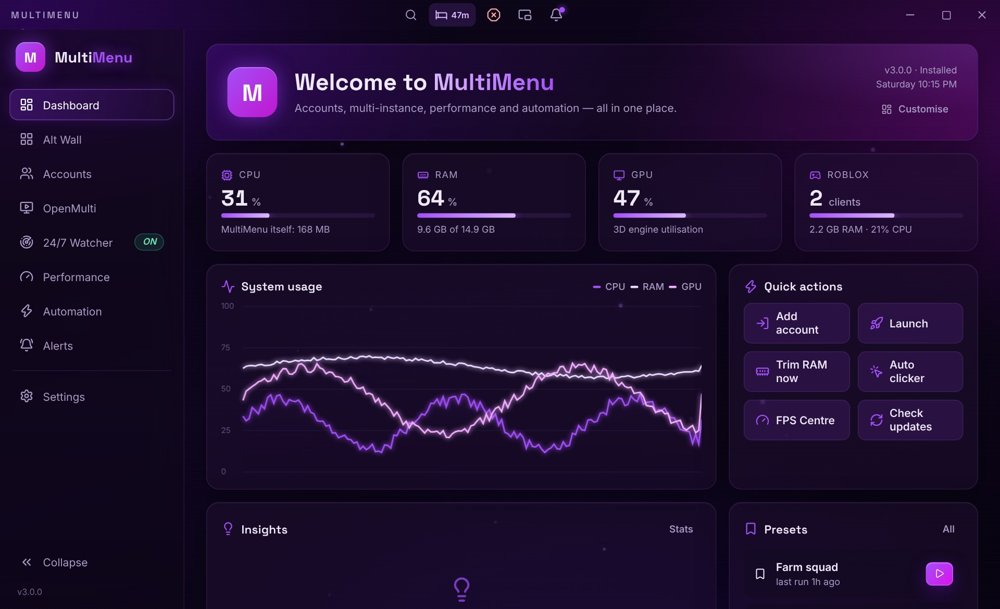
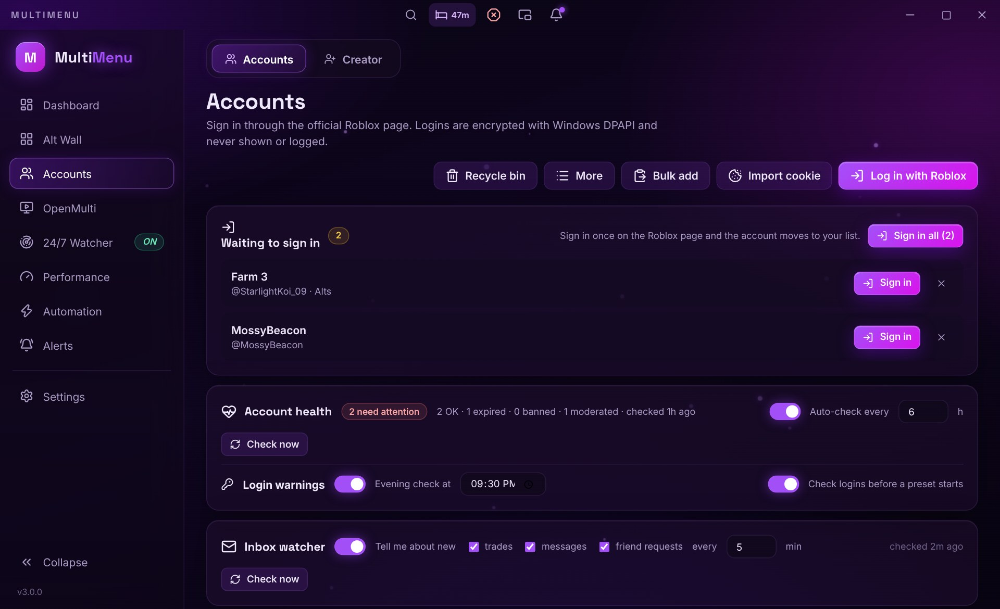
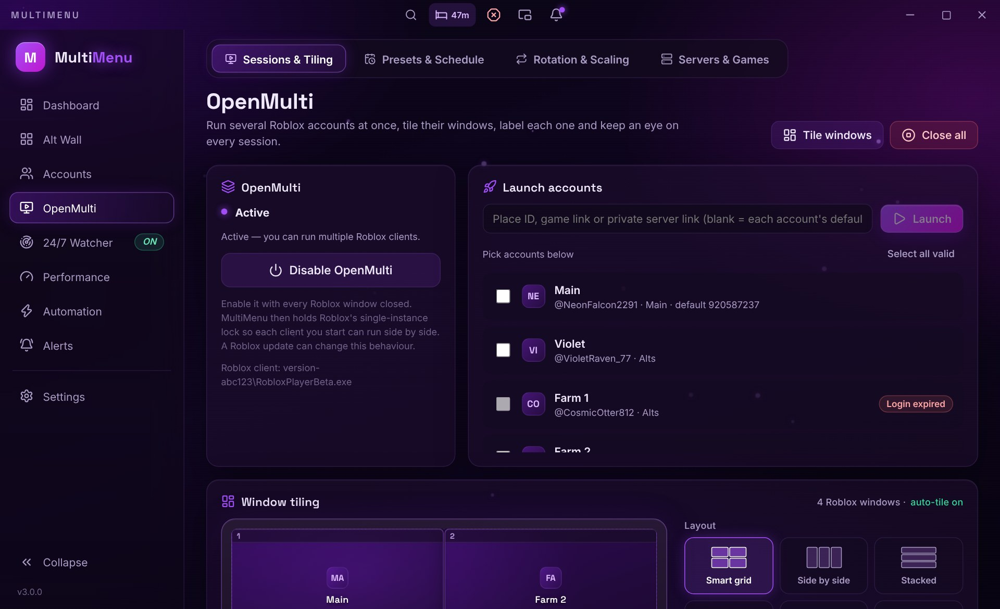
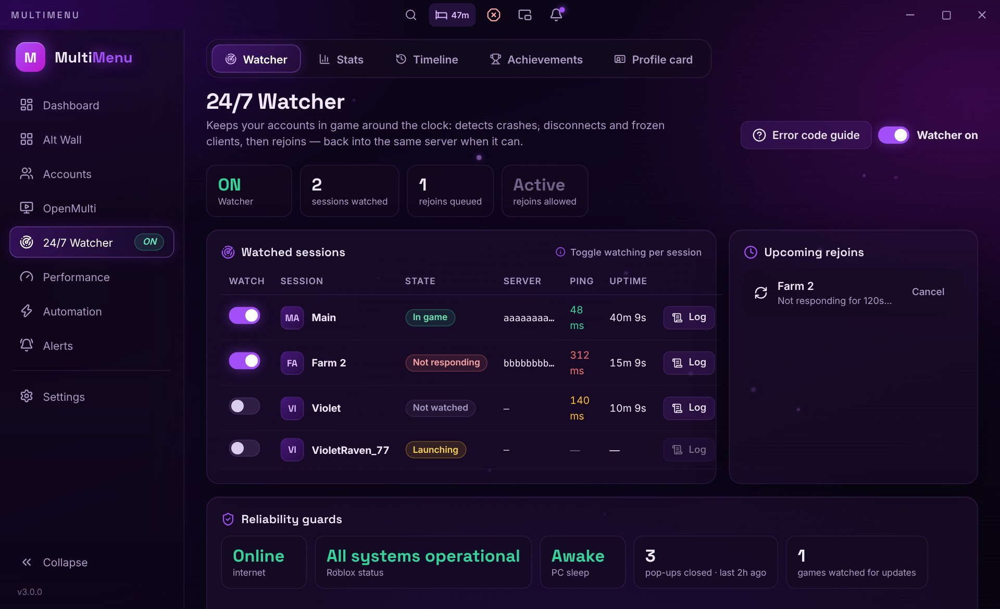
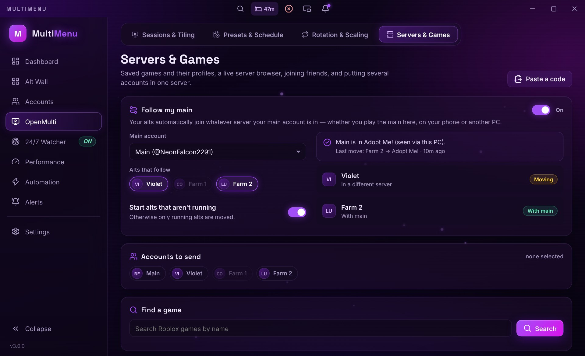
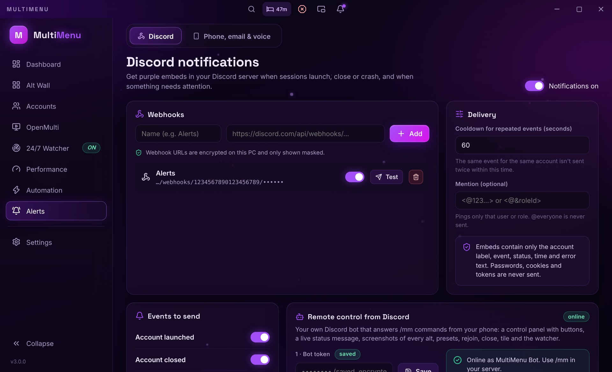

<div align="center">


# MultiMenu

**Run as many Roblox accounts as your PC can handle, in one free app.**

Multi-instance launching, auto-rejoin, window tiling, performance tuning and Discord alerts for Windows 10/11. Free and open source.

[](https://github.com/MultiMenu/MultiMenu/releases/latest)
[](https://discord.gg/nCZD8NQC9Y)




</div>

## Why MultiMenu

- 🚀 **Launch many alts in one click**, side by side, all into the same server if you want
- 🔁 **24/7 auto-rejoin** after crashes, kicks, freezes and stuck loading screens
- 🪟 **Tile every window** into a neat grid, or draw your own layout
- ⚡ **Run more alts on the same PC** with performance presets, lighter rendering, eco mode and a RAM trimmer
- 🥚 **Hatch alerts and a hatch counter** for any game: a Discord ping with a screenshot when an alt hatches a rare pet
- 🛡️ **Check every account at once**: security, Robux, limited item value and who owns which game passes
- 🔔 **Alerts on Discord, Telegram, phone or email**, plus a Discord bot and a phone dashboard to control everything remotely
- 🔒 **Your logins stay on your PC**, encrypted with Windows DPAPI, and are only ever sent to Roblox itself
- 🆓 **Free and open source**, no ads, no paywall

## Screenshots

| | |
|---|---|
|  |  |
| **Accounts**: tiers, tags, groups and one-click sign-in | **OpenMulti**: launch accounts and tile their windows |
|  |  |
| **24/7 Watcher**: auto-rejoin and reliability guards | **Servers & Games**: follow your main, find a game |
|  | |
| **Discord**: webhook alerts and a remote-control bot | |

## Download

Get it from the [latest release](https://github.com/MultiMenu/MultiMenu/releases/latest):

| File | What it is |
|---|---|
| `MultiMenu-Setup.exe` | **Recommended.** Installer with shortcuts, an uninstaller and automatic updates. Data lives in `%APPDATA%\MultiMenu`. |
| `MultiMenu-Portable.zip` | Extract anywhere and run `MultiMenu.exe`. Data lives in `MultiMenu-Data\` next to the exe. |

MultiMenu isn't code-signed yet, so Windows SmartScreen may warn the first time you run it: click **More info → Run anyway**. You can check the files against `SHA256SUMS.txt` on the release.

Questions, ideas or bugs? Join the [Discord server](https://discord.gg/nCZD8NQC9Y).

---

# Developer notes

## 1. Credits

MultiMenu is its own code. Tiny windows and a few performance ideas were adapted from RoALT (MIT licence); see `NOTICE.md` for the details and every third-party licence.

## 2. Built with

Electron (the interface, and the sandboxed Roblox login window), `koffi` for the Win32 calls (no compiler needed), and electron-builder for the installer and the portable zip. Electron isn't the lightest option, so MultiMenu keeps its own footprint down:

- **Low-resource mode** turns off animation and blur and slows sampling.
- **Particles pause** whenever the window is hidden.
- **One shared process snapshot** serves the monitor, sessions and the trimmer.
- **GPU monitoring** can be switched off.

## 3. Architecture

```
┌──────────── Renderer (sandboxed, no Node) ────────────┐
│ index.html + css/app.css + js/pages/*.js               │
│ talks only through window.mm.invoke()/on()             │
└───────────────▲───────────────────────────┬───────────┘
                │ allow-listed IPC (preload.js)│ push events
┌───────────────┴───────────────────────────▼───────────┐
│ Main process                                           │
│  ipc.js  ── command table (one handler per UI action)  │
│  bus.js  ── event bus → notifications, Discord, UI     │
│  modules/ accounts · creator · roblox · sessions · tiler│
│           watcher · robloxlogs · stats · presets ·     │
│           scheduler · limiter · audio · servers · backup│
│           remote · report · health · capture           │
│           zipdelta                                     │
│           processes · system · fps · ramtrimmer ·      │
│           clicker · macros · antiafk · hotkeys ·       │
│           webhooks · notifications · updater · settings│
│  2.0:     commands · api · overlay · wall · rotation · │
│           autoscale · gameprofiles · perfprofile ·     │
│           rflags · automations · speech · alertapps ·  │
│           phone · insights · healthscore · doctor ·    │
│           timeline · achievements · sharecodes ·       │
│           gallery · tinykeep                           │
│  cli.js ── named pipe for `mm <command>`               │
│  native/win32.js ── koffi bindings to user32/kernel32  │
│  secure.js (DPAPI) · store.js (atomic JSON) · logger.js│
└────────────────────────────────────────────────────────┘
```

Security model:

- **Renderer.** Sandboxed, with context isolation and a strict CSP. Only allow-listed IPC calls are possible, and they're accepted only from MultiMenu's own window.
- **Secrets.** Cookies, saved passwords and webhook URLs are encrypted with Windows DPAPI via Electron `safeStorage`. They never reach the renderer, and every log line is passed through a redaction filter.
- **No telemetry.** The only network traffic is Roblox (your accounts), GitHub (update checks and the theme gallery list), rolimons.com (item values on Items & security, can be switched off) and the alert services you set up yourself (Discord, Telegram, ntfy, Pushover, your email server). Alerts carry allow-listed fields only, never logins, cookies or tokens.
- **Local control.** The phone dashboard, local API and command line are all off by default (the command line needs MultiMenu running as your Windows user). See the 2.0 notes below.
- **Imports.** Config, cookie and macro files are size-limited and schema-validated before use.

## 4. Folder structure

```
MultiMenu/
├─ package.json                 app metadata, scripts, update repo
├─ electron-builder.yml         installer + portable zip config
├─ LICENSE.txt                  MIT + third-party notices
├─ NOTICE.md                    credits and third-party licences
├─ CHANGELOG-release.md         release notes used by CI
├─ themes/index.json            the online Theme gallery list (theme share codes)
├─ streamdeck/                  Stream Deck plugin source (built into the app)
├─ build/                       icon.ico/png, tray.png, installer sidebar/header BMPs, logo.svg
├─ src/
│  ├─ main/
│  │  ├─ main.js                app lifecycle, window, tray, boot order
│  │  ├─ preload.js             the only UI↔main bridge
│  │  ├─ ipc.js                 command table + setting validation
│  │  ├─ selftest.js            `MultiMenu.exe --self-test`
│  │  ├─ paths.js  store.js  secure.js  logger.js  bus.js
│  │  ├─ native/win32.js        Win32 API via koffi
│  │  └─ modules/               one file per feature
│  └─ renderer/
│     ├─ index.html
│     ├─ css/app.css            theme (purple/black, glass, glow, reduced-motion)
│     ├─ css/v2.css look.css    2.0 pages, light mode, compact, high contrast
│     ├─ fonts/                 Inter + Space Grotesk (OFL)
│     └─ js/ ui.js app.js icons.js pages/*.js
├─ scripts/                     checksums, self-test check, icons, Stream Deck build, i18n tools
├─ test/                        unit tests + UI screenshot harness
├─ docs/                        font and icon licences, README screenshots
└─ .github/workflows/release.yml  build → test → self-test on Windows → release
```

## 5. Running from source

Install Node.js 22, then:

```powershell
git clone https://github.com/MultiMenu/MultiMenu.git
cd MultiMenu
npm install
npm start            # run the app
npm test             # unit tests
npm run dist         # build dist\MultiMenu-Setup.exe and dist\MultiMenu-Portable.zip
npm run checksums    # write dist\SHA256SUMS.txt
```

## 6. Publishing updates (GitHub Releases)

One-time setup:

1. Optionally, set `"updateRepo": "<you>/<repo>"` in `package.json`. The CI workflow fills this in automatically.

For each release:

1. Bump `"version"` in `package.json` (e.g. `1.1.0`) and edit `CHANGELOG-release.md`.
2. Commit, then tag and push:
   ```powershell
   git commit -am "Release 1.1.0"
   git tag v1.1.0
   git push --follow-tags
   ```
3. GitHub Actions builds on Windows and runs the tests. It installs and self-tests both builds, then publishes a Release containing `MultiMenu-Setup.exe`, `MultiMenu-Portable.zip` and `SHA256SUMS.txt`.

Running copies of MultiMenu check for updates at startup and every 6 hours, then show the **MULTIMENU UPDATE AVAILABLE** popup. Tags with a hyphen (e.g. `v1.2.0-beta.1`) become pre-releases, which only the **Beta** channel receives.

How updates install:

- **Installer build.** Downloads the new setup, verifies its SHA-256, and runs it silently. `%APPDATA%\MultiMenu` is untouched.
- **Portable build.** Downloads the zip, verifies it, then copies the new files over the app folder after MultiMenu exits. `MultiMenu-Data\` is skipped, so your data stays.
- **Code signing (optional).** Add `CSC_LINK` and `CSC_KEY_PASSWORD` repository secrets to sign the `.exe`. You can then turn on **Settings → Updates → Require a code signature**.


## 7. Feature notes and known limits

- **Accounts.** Logging in opens the real `roblox.com/login` in a throwaway, sandboxed session. The cookie is read only from that session, then the session is wiped. Cookie import accepts a single pasted value or a `.txt`/`.json` file. Nothing is ever read from browsers or other apps.
- **Account Creator.** Fills in the username and password on the official signup page. You pick your birthday, solve the CAPTCHA and press Sign Up. Only one window can be open at a time, and there's no bulk creation.
- **Window tiling (OpenMulti page).** A live monitor preview shows where each Roblox window will go.
  - **Layouts:** Smart grid, Side by side, Stacked, 2×2, 3×3, 4×4, Main + side, Cascade, Fixed size and Tiny windows, plus **layouts you draw yourself** (zones stored as fractions of the screen, so they work on any monitor; they also work in presets, game profiles and share codes).
  - **Options:** choice of monitor, gap, edge margin and auto-tile for new clients.
  - **Order:** click two windows in the preview to swap them, or use the list.
  - **Window controls:** restore original positions, show or minimise all, and bring to front, minimise or pin on top for each window.
  - **Placement:** DPI-aware, and it compensates for Windows' invisible borders so tiles meet edge to edge.
  - **Minimum size:** Roblox can enforce its own minimum window size, so very dense grids may overlap slightly.
- **24/7 Watcher.** Watches each session for three problems:
  - **Crashes:** the process exits on its own.
  - **Disconnects:** read from Roblox's own log in `%LOCALAPPDATA%\Roblox\logs`.
  - **Freezes:** Windows reports the window as "not responding" for longer than you allow.

  It then rejoins with exponential back-off, a maximum number of rejoins per hour and optional quiet hours. Its first try goes back into the same server (the server ID comes from the log), and later tries join the game. If Roblox changes its log format, disconnect detection needs updating; crash and freeze detection don't depend on the log.
- **Presets & Schedule.** A preset bundles accounts, game, same-server mode, layout, watcher, limiter, Anti-AFK, graphics and an auto-close timer. Scheduled tasks run daily at a time or every N hours.
- **Discord status.** While alts are running, the Discord profile shows "Playing MultiMenu" with how many are running and the game (never account names). It talks to the Discord desktop app on the same PC over its local pipe (`\\.\pipe\discord-ipc-N`) with the public application ID `1570111240066568353`; nothing goes over the internet from MultiMenu. It is always on; people can hide all their activity in Discord (User Settings → Activity Privacy).
- **Launch queue.** Launches run one at a time. While any are waiting, a title-bar chip opens the queue: order with an ETA, drag to reorder, launch one next, remove one, "Next now" to skip the settle wait, or clear the rest. The panic button empties it.
- **Items & security (3.1).** `accountcheck.js` only reads. Security uses the endpoints the roblox.com security page uses (2-step configuration, email, phone, PIN) and keeps only booleans and a rating, never the email address or number. Robux and pending Robux come from the economy API; limiteds from the collectibles inventory (10 pages at most), valued with Rolimons' public item list (cached for an hour, `wallet.rolimons`) or RAP. Game passes are checked per account through the inventory API (40 passes at most), badges in one awarded-dates call (100 at most). Results live in `accountcheck.json`.
- **Private servers (3.1).** `privateservers.js` lists each account's own private servers, reads the join link from the owner's server details only when you launch or save one, and warns once per server and expiry date (`privateServers.warnDays`) when one that won't renew is about to end.
- **Smart join (3.1).** Up to 3 pages of public servers; lowest ping (Roblox's own figure for the server), fewest players, or groups of N alts each in a different server with room for the whole group.
- **Update guard (3.1).** Compares Roblox's current `clientVersionUpload` with the `version-*` folders that contain a player (Roblox, Bloxstrap, Fishstrap). When two or more launches are queued and Roblox is out of date, the first one goes through Roblox's own launcher (so it updates) and the rest wait until the new folder exists, at most `updateGuard.maxWaitSec`. Single launches and PCs where no Roblox folder is found are never held back.
- **All monitors (3.1).** `tiling.display = 'all'` shares windows between monitors in proportion to their work area (largest remainder) and lays each monitor out with the chosen layout. Focus mode stays on the main monitor.
- **Volume mixer (3.1).** The audio helper (`native/AudioMute.cs`) also sets `ISimpleAudioVolume` levels. Levels are kept per account and set again 3 s and 60 s after an alt joins, because Roblox opens its audio late. An alt at 100 % that was never changed is left alone.
- **Network (3.1).** `netstat -e` every 5 s gives the PC's received and sent bytes (any Windows language; 32-bit wraps handled). Windows has no per-app numbers without admin rights, so "per alt" is the total shared between running alts. The data cap warns at 80 % and at 100 %, where it can close Filler alts.
- **Fresh restarts (3.1).** At most one restart per `freshRestart.gapMin`, oldest session first, never while launches are queued, never the focused window, and Main accounts are skipped unless you turn that off. Restarts go back into the same server like the memory guard's.
- **Logs (3.1).** The newest 60 player logs, the last 3 MB of each (1 MB when searching all). Lines are redacted like the session log viewer and sorted into joins, disconnects, teleports and errors; disconnect codes use the same table as the watcher.
- **Bug fixes (3.1.1).** Calls that could wait on a busy Roblox window now never block: titles are set with `SendMessageTimeoutW` on a koffi worker thread (2 s, `SMTO_ABORTIFHUNG`), and another program's window is shown, minimised and moved with `ShowWindowAsync` and `SWP_ASYNCWINDOWPOS`. Every `desktopCapturer.getSources` call goes through one queue in `capture.js`. `robloxlogs.findLogFor` shares one folder listing for 3 s and skips logs whose name gives another start time. Auto-tile (`tile({ auto: true })`) leaves minimised windows out and keeps tiny alts tiny; a tile asked for during another runs after it. The watcher boosts a hung client through the limiter for one more `freezeSec` before restarting it. `guards.restartOnUpdate` is off by default (a one-time migration turns it off). The RAM Trimmer opens processes with `PROCESS_QUERY_LIMITED_INFORMATION | PROCESS_SET_QUOTA` only. `startup.json` keeps an `open` flag, and Electron's crash reporter writes dumps to `logs/crashes` (nothing is uploaded).
- **Community features (3.1.1).** Held Roblox updates (`updateGuard.hold`: off, whileOpen, always): the launch gate returns `direct: true` so the installed `RobloxPlayerBeta.exe` starts without the updater (`findRobloxPlayer` prefers version folders that have `AppSettings.xml`), and a 1 s check ends `RobloxPlayerInstaller.exe` while updates are held; "Update Roblox now" opens `roblox-player:1+launchmode:app` and lets updates through for 15 minutes. `serverhop.js` watches clients sent to a public server by job ID and, if the log shows no `serverId:` within 60 s of the join or a disconnect first, launches the account into the place again. Batches (`launch.batchSize`) wait for `session:joined` from every client of the batch, then the CPU settle. `titlebars.js` takes `WS_CAPTION | WS_THICKFRAME` off game windows every 3 s while `tiling.hideTitleBars` is on and puts the old style back when it's turned off. Rich Presence reads `richPresence` settings (on/off, count, game, two text lines with `{count}` and `{game}`); the button stays. The remote bot DMs a Rejoin button (`mm:again:<accountId>:<placeId>`) on `session:ended` when `remote.alertClosed` is on. `themes.wallpaperEngine()` reads `project.json` of Workshop item 431960 folders in every Steam library and lists video ones; the page picks by index, never by path.
- **Lighter MultiMenu (3.1.1).** `lean.js`: `paced()` wraps the frequent timers (sessions, limiter, tiny windows, guards, title bars, watcher, network monitor, server hop, clipboard, RAM Trimmer watch) so they run every 1st, 2nd or 4th tick (`performance.checkSpeed`; low-resource mode is at least relaxed). Event forwarding goes through `lean.send`, which keeps only the latest live event per window while it's hidden and sends them on `show`/`restore`. `performance.trimSelf` trims MultiMenu's own processes a minute after the window hides. `performance.endCrashHandlers` ends `RobloxCrashHandler.exe` every 15 s. Particles are capped at 30 fps and pause on window blur with the background video (`appearance.pauseUnfocused`).
- **Potato preset (3.1.1).** `perfprofile.PRESETS.potato`: 5 FPS, every allowlisted lighter-rendering flag, `perf.reducedMotion` (written to `<bool name="ReducedMotion">` in GlobalBasicSettings only when the file has it), tiny, minimised, muted, eco and the RAM Trimmer. Removing or greying the map itself would need code running inside the game, which Roblox treats as exploiting, so it isn't offered.
- **Hatch alerts (3.1).** `hatch.js` matches three things it may see without touching the game: lines the game prints to each client's Roblox log (ignored for 45 s after joining, while games print owned pets), Roblox's badge API for games with a badge per rare pet, and Windows' own text recognition (`ocr.js`, `Windows.Media.Ocr` through PowerShell) on each Roblox window, one capture per round (`screenwatch.js`). Matching allows about one wrong letter in eight for screen text, and lines naming another player are ignored. Nothing game-specific ships: games, words and pet names start empty apart from the word "secret".
- **Watcher teleports (3.1).** A `initiateTeleport` line alone no longer puts a session back into "loading": only the leave from the old server that follows a real teleport (within 60 s) does. Before this, a game printing that word or a teleport that failed made the watcher call a playing alt "stuck loading".
- **Pinned windows.** Pin on top from Sessions & Tiling, the Alt Wall or a hotkey. Pins are remembered per account and come back after a rejoin.
- **Find a game.** Searches Roblox games by name. The search uses Roblox's undocumented `apis.roblox.com/search-api/omni-search` only to get game IDs; names, player counts, likes and icons come from the documented games, votes and thumbnails APIs. Icons are only shown from Roblox's own image host.
- **Account list export.** Accounts → More → Export list: CSV (spreadsheet-safe: cells can't become formulas) or a text list, with chosen columns. Built only from the renderer-safe account view, so passwords and logins can't be in it.
- **Servers.** Includes the public server browser, join emptiest, join a friend (follows them, which needs their joins to be open to you), squad join, and saved games and private servers.
- **Background limiter.** Sets the priority and CPU-core affinity of background Roblox clients, and can mute them. Muting uses a small C# helper (`src/main/native/AudioMute.cs`) that PowerShell compiles once using the Windows Core Audio API. Stopping the limiter restores normal priority, all cores and sound.
- **Encrypted backup.** A password-protected `.mmvault` file (scrypt + AES-256-GCM) that can be restored on any PC. Anyone with the file and the password can use the accounts in it.
- **Mini panel.** A compact always-on-top window (Ctrl+Alt+M) showing sessions, the watcher, tile/hide/stop controls and preset start. The shrink button turns it into a small strip with one status dot per account.
- **Languages.** English, Spanish, German, French, Portuguese (Brazil), Norwegian, Italian, Polish, Turkish, Russian, Indonesian, Vietnamese and Filipino. Pages are written in English and translated as they render (`src/renderer/js/translate.js` + `i18n.js`), using the dictionaries in `src/i18n/<id>.json`. After changing UI text, run `npm run i18n:extract` to refresh the list of strings and `npm run i18n:check` to see what each language is missing.
- **Switching from Roblox Account Manager.** Reads only the username, alias, group and description from its `AccountData.json` (or from a pasted list). Saved cookies and passwords are ignored and never stored. Imported accounts wait under "Waiting to sign in" until you log in to each one on the official page.
- **Bloxstrap / Fishstrap.** Settings → Accounts → Launch method can send every launch through either bootstrapper, using the command it registered for itself when it is the current Roblox link handler.
- **Discord remote control.** Your own bot (token stored encrypted) registers a `/mm` slash command. It uses the Gateway with only the GUILDS intent; no privileged intents are needed. Only Discord user IDs on your allow-list are obeyed. To set it up: Developer Portal → New Application → Bot → Reset Token. Paste the token and your user ID on the Discord page, press Connect, then "Add bot to my server".
- **Daily report and screenshots.** The daily report is sent through your webhooks. Screenshots use Electron's window capture; minimised windows can't be captured.
- **Account health.** Uses Roblox's public profile endpoint (`isBanned`), the logged-in check, and the moderation notice the website shows.
- **Smaller updates.** CI publishes `MultiMenu-files.json` (a SHA-256 for every file, itself listed in `SHA256SUMS.txt`). The updater hashes your installed files and downloads only the changed ones out of the release zip using HTTP Range requests. It verifies each file, and falls back to the full download if anything is off.
- **Idle mode.** While the window is hidden, system sampling drops to every 10s and the GPU reader stops.
- **Error codes.** `src/main/modules/errorcodes.js` maps Roblox disconnect codes to plain-English text and a watcher action: rejoin, new server, slow rejoin, or stop. "Stop" covers codes where rejoining would loop or can't help, such as 264/273 (logged in elsewhere) and 524 (not allowed to join).
- **Memory guard.** Samples each client's RAM every minute and fits a least-squares trend over the last hour. It restarts a client into the same server when it's over the limit or growing faster than your threshold, one at a time, never the focused window, and only after the minimum uptime.
- **Outfits.** Wearing an account's own outfit uses Roblox's wear endpoint, falling back to applying the outfit item by item. Copying an outfit to other accounts applies its items, body colours, scale and avatar type; items an account doesn't own are skipped and reported.
- **Friend my alts.** One account sends a friend request and the other accepts. CAPTCHA challenges are never bypassed: affected pairs are listed, and it pauses after two in a row.
- **Resume after restart.** A snapshot of running sessions (account, game, exact server, label, watch flag) is kept in `resume.json`. It's cleared when you close everything yourself, and kept when clients die from a shutdown or crash. On the next start, MultiMenu offers to resume, or resumes automatically if you've chosen that.
- **Follow my main.** Every 30s it reads the main's server, either from its log on this PC or from Roblox presence when you play elsewhere. Once the main has been in a new server for 20s, alts are moved there one at a time, at most once a minute each.
- **Automatic backups.** A daily `MultiMenu-auto-YYYY-MM-DD.mmvault` in the same encrypted format as manual backups, keeping the newest N. The password is stored with DPAPI. Pruning only touches files that match that name pattern.
- **Stats.** Per-day, per-account and per-game history kept for 400 days, used for the totals, streaks, heatmap, leaderboard and monthly Wrapped ("Save as image" captures the card).
- **Reliability guards (v1.6).** Keeps Windows from sleeping while clients run (Electron's `powerSaveBlocker`, so the screen can still turn off). Checks your connection every 20s and Roblox's public status page every 5 minutes; rejoins wait while either is down. Watches each running game's "last updated" time every 3 minutes and can move clients on old servers to fresh ones. Closes standard Windows dialogs owned by a Roblox client and the Roblox crash reporter. Pings each client's game server (IP from the Roblox log) every 30s with Windows' `ping`.
- **Open roblox.com as an account.** Opens a separate, throwaway browser window signed in as that account (its own session, cleared on close). Log-out links are blocked so the saved login isn't invalidated, and navigation stays on roblox.com.
- **Inbox watcher.** Polls Roblox's trade, message and friend-request counts per account and notifies (and optionally posts to Discord) when a number goes up. Counts only; message contents are never read.
- **Per-account colours and graphics.** Colour shows on cards, the session list and the palette. Launch graphics write Roblox's settings file just before that account starts (launches are sequential, so each client reads its own value).
- **Playtime reminders and sleep timer.** Reminders skip sessions the 24/7 Watcher looks after. The sleep timer turns watching off for those clients, closes them, then optionally sleeps the PC or runs `shutdown /s /t 60` (cancel with `shutdown /a`).
- **Copied-link detection.** Reads the clipboard every 1.5s only to match `roblox.com/games/…` and `roblox.com/share?…` links; nothing else is stored, logged or sent. Turn off in Settings.
- **Desktop shortcuts and jump list.** Shortcuts run `MultiMenu.exe --preset=<id>` / `--account=<id>`; if MultiMenu is already running the arguments are handed over to it.
- **Command palette.** Ctrl+K anywhere: pages, settings toggles, accounts (launch / open website), presets, themes and commands.
- **PC capacity test.** The estimate divides your free RAM/CPU/GPU headroom by what the running clients use on average. The live test launches chosen accounts one at a time and stops at RAM 85%, CPU 90% or GPU 95%.
- **Deep idle.** After N minutes hidden in the tray, the window (and its renderer process) is destroyed; background work continues and the window is rebuilt when opened.
- **Profile card.** A picture made from your local Stats (hours, launches, best streak, top games), saved with the same window capture as Wrapped.
- **From the old AHK multi-tool (v1.6.1).** Windows of Roblox clients opened *outside* MultiMenu are named after their account too: the Roblox log created when the process started is found, the user ID is read from it, and the public users API gives the name. The RAM Trimmer can trim any Roblox client the moment it goes over a set size (checked every 5 s, at most once a minute per client). Anti-AFK presses a sequence of keys (with a Record button), and windows that were minimised are minimised again afterwards.
- **Ideas from RoALT (v1.6.1).** Anti-AFK only acts while you're away from the PC (Windows idle time) and defaults to F13; an hourly Roblox log cleaner; minimise new clients on launch; your own Roblox graphics are put back after an account with its own launch graphics has started (and again when it closes, with a copy on disk in case MultiMenu closes first); "Lock purchases" in the roblox.com-as-account window (paid purchases and the Robux/Premium pages are blocked, free items allowed); a "Close all Roblox" panic hotkey that also stops queued launches and rejoins; and "Play again" on ended sessions. These were re-implemented from RoALT's feature descriptions, not copied. RoALT is © 2026 inspectsoftware, MIT License, https://github.com/inspectsoftware/RoALT.
- **Theme studio.** Presets, two accent hues, glow, glass blur and a gradient / plain / image / looping video background (copied into the data folder; the page loads it as a `blob:` URL). Themes export to `.mmtheme` (images under 8 MB are embedded; every value is clamped on import).
- **Phone dashboard (v1.8).** `src/main/modules/phone.js` is a small Node `http` server (port 43821 by default), off until you turn it on. It answers only private-network addresses (RFC 1918, link-local, IPv6 ULA) and only Host headers that are IP literals (blocks DNS rebinding). Everything except the page needs a sign-in with a 6-digit PIN, stored as a salted scrypt hash and compared in constant time; tokens live in memory for 12 hours. Wrong PINs lock a device for 5+ minutes and everyone for 10 minutes after 20 failures. Replies carry names, game, state, uptime and memory only — never cookies, passwords, webhooks or tokens. A view-only switch blocks every action. The connection is plain HTTP on your LAN, so the UI warns against using it on school, work or public Wi-Fi.
- **Stuck loading (v1.8).** When a watched client's Roblox log shows no server join for N minutes (default 5) after launch or a teleport, the watcher treats it like a freeze and rejoins.
- **Login warnings (v1.8).** Uses the account-health check: before a preset launches (expired accounts are skipped and named), 30 minutes before a scheduled preset, and at a set evening time for accounts in presets, favourites or used in the last 14 days. A check younger than 20 minutes is reused.
- **Diet mode (v1.8).** Read from settings before Electron starts: caps the renderer JS heap (`--max-old-space-size=192 --lite-mode`), shrinks the disk cache, limits renderer processes, forces low-resource visuals and deep idle after 3 minutes. Needs a restart.
- **Safe mode (v1.8).** `startup.json` counts starts that didn't reach 60 healthy seconds; two in a row start the next one in safe mode. Safe mode skips the watcher, scheduler, hotkeys, trimmer, limiter, anti-AFK, remote bot, phone dashboard, resume, follow, auto-backup, guards, inbox, custom backgrounds and per-monitor layouts. Updates still work.
- **Layouts per monitor setup (v1.8).** A signature of every display's size, scale and position keys a saved copy of the tiling settings in `layouts.json`; on `display-added/removed/metrics-changed` the matching layout is applied and running windows re-tiled.
- **Focus mode and picture-in-picture (v1.8).** Focus mode is the `main` layout with the focused session first (ratio 50–85%, strip left or right). PiP is a frameless always-on-top window that uses `getDisplayMedia`; the main process's `setDisplayMediaRequestHandler` answers only that window with exactly the chosen Roblox window, and only it gets the `media`/`display-capture` permission.
- **Tiers, tags and the recycle bin (2.0).** Each account is Main, Important or Filler. Main accounts are never throttled, closed by auto-scaling or put in eco mode, and launches go Main → Important → Filler. Tags (up to 10 per account) feed saved filters, and presets can target a tag instead of fixed accounts. Deleted accounts sit in a recycle bin for `accounts.binDays` (30 by default, 0 deletes at once).
- **Alt performance (2.0).** `perfprofile.js` applies a preset (Max alts, Balanced, Roblox defaults) or your own values to alts only: FPS cap and lowest graphics through Roblox's settings file, lighter rendering, start tiny, minimise and mute once in game, eco mode and the RAM Trimmer. "For this PC" measures your running alts for about 25 seconds and checks the count you plan for against your memory and CPU. Every change is shown for review before it is applied.
- **Lighter rendering (2.0).** `rflags.js` merges only Fast Flags from Roblox's allowlist for local client configuration into `ClientSettings\ClientAppSettings.json` just before an alt starts, then puts your own file back exactly as it was once the client is running (a copy waits beside it in case of a crash). Bloxstrap and Fishstrap overwrite that file at launch, so with them use their own Fast Flag editor. Learned from RoALT, see NOTICE.md.
- **Eco mode and smart launch (2.0).** Eco mode uses `SetProcessInformation(ProcessPowerThrottling)` with below-normal priority for background alts (idle priority until 3.1.1, which starved busy alts). Smart launch waits after each client until CPU use stays under `launch.cpuSettle` for three samples (at least 3 s, at most `launch.maxWaitSec`).
- **Rotation and auto-scaling (2.0).** Rotation keeps N alts from a pool running and swaps them round robin every M minutes (closing the outgoing alt first). Auto-scaling keeps a RAM and CPU budget: it scales up highest tier first, scales down Filler then Important (never Main), newest first, with cooldowns, hysteresis and no scale-up in quiet hours.
- **Game profiles (2.0).** Per place ID: graphics, layout, watcher limits (stuck minutes, freeze seconds, rejoins per hour) and eco. An account's own graphics win over the game's.
- **Alt Wall, overlay and alt hotkeys (2.0).** The Alt Wall and switcher get thumbnails from one `desktopCapturer.getSources` call (JPEG, nothing saved). Overlay labels are one transparent, click-through window per monitor, shown only while a Roblox window or MultiMenu is in front. Since 3.1.1 a label is hidden while its window moves and when another window covers its corner (`win32.windowStack` walks the z-order with `EnumWindows`, skipping cloaked and click-through windows, and sends nothing to any window). Alt hotkeys are off by default; Ctrl+Alt+1–9 focuses that slot's alt or launches it (AltGr layouts get a warning because AltGr is Ctrl+Alt).
- **Automations (2.0).** Rules of trigger, conditions and actions with a cooldown, driven by app events plus a 15 s poll for state triggers, under a global rate limit and with a run log. Imported rules start switched off.
- **Voice alerts (2.0).** One long-lived PowerShell `System.Speech` process, fed text on stdin.
- **Alert apps (2.0).** Telegram, ntfy, Pushover and email (nodemailer). Tokens and passwords are DPAPI-encrypted; each channel picks its events; a shared cooldown stops repeats; messages are built from allow-listed fields only.
- **Discord bot 2.0.** `/mm panel` (menus and buttons), `/mm live` (one message edited every 60 s; its IDs are kept in `remote.json`), `/mm screenshots` (up to 10 JPEGs) and name autocomplete for accounts and presets.
- **Tiny windows (2.0.1).** Adapted from RoALT 1.1.0 (MIT, see NOTICE.md). Roblox holds its window to a minimum (`WM_GETMINMAXINFO`), which Windows only applies while a window has a sizing frame. `win32.freeResize` takes the frame off for one `SetWindowPos` and puts it straight back (`SWP_FRAMECHANGED` without a size change), so the window keeps its title bar at any size. These calls run on koffi worker threads (`fn.async`), one resize per window at a time, and windows that aren't responding are skipped. `tinykeep.js` sweeps every 2 s and puts a tiny window back when Roblox has grown it (after a restore or a title-bar drag). It leaves alone the window in front, a maximised, minimised or hung one, anything while a mouse button is held, and windows sized on purpose in the last 10 s. If Roblox won't go that small, the size it stays at is adopted, and so is the size of a window Roblox grows back 3 times in 5 minutes. The tiny size (`perf.tinyW` × `perf.tinyH`, 16–7680 px) is the game picture. The Tiny windows layout adds the frame, and every other layout falls back to `freeResize` when a cell is below Roblox's minimum. `tiler.tile()` is async now.
- **Phone dashboard 2.0.** Installable from the browser (web app manifest and icons), live thumbnails at `/api/thumbs`, a launch action, and remembered devices: a device can stay signed in for 30 days with only a hash of its token stored. Settings lists remembered devices, and each one (or all) can be signed out.
- **Phone dashboard reliability (2.0.1).** Idle connections stay open 30 s (the page refreshes every 5 s; with both at 5 s a phone could reuse a connection just as it closed). The page retries a dropped request twice, refreshes one at a time with back-off, shows a "Can't reach your PC" banner after two failures, and doesn't redraw while a finger is on the screen. Every action carries an id, and a retry with the same id within 2 minutes gets the first answer instead of running again. Settings → Phone → *Check connection* reads (never changes) the network category and the Windows Firewall rules for `MultiMenu.exe` through PowerShell, and explains Public networks, blocking rules and VPNs. VPN and virtual adapters sort last for the QR code, and the user is told when the PC's address changes.
- **Command line and local API (2.0).** `mm <command>` (`build/mm.cmd`, next to `MultiMenu.exe`) runs `MultiMenu.exe --cli …`, which talks to the running app over a named pipe that only your Windows user can open. The local API listens on `127.0.0.1:43822` only, is off by default, needs the API key (`Authorization: Bearer …`, DPAPI-encrypted, shown and renewed in Settings), refuses other Host headers and browser requests, and locks for a minute after 10 wrong keys. `GET /api/v1/help` lists the commands; read-only commands use GET, the rest POST. Both share one command table (`commands.js`) with the Stream Deck plugin.
- **Stream Deck plugin (2.0).** `streamdeck/` holds an SDK 2 Node plugin with its own small WebSocket client. It calls the local API with the key you paste into its settings. `npm run streamdeck` zips it to `MultiMenu.streamDeckPlugin`, which the app ships in its resources.
- **Share codes (2.0).** `MM2-<kind>-<base64url(deflate(JSON))>-<CRC-32>` for presets, layouts, themes, automations and game profiles. Fields are allow-listed per kind on the way out and again on the way in, codes are capped at 8,000 characters, damaged codes are refused by the checksum, and anything that looks like a sign-in cookie, webhook, bot token, API key or private server link is refused in both directions. Codes never include accounts.
- **Theme gallery (2.0).** Built-in themes plus `themes/index.json` from this repository's main branch (cached for 6 hours, at most 120 entries). Each entry is a theme share code and goes through the same checks. "Try" applies a theme and "Go back" restores your previous one, including your own background file.
- **Insights, health score, timeline and achievements (2.0).** All computed locally from Stats. The timeline shows session spans for 14 days. Wrapped covers this month, last month and the year.
- **Doctor (2.0).** Checks the setup (Roblox, OpenMulti, launcher, expired logins, Roblox log size, hotkey clashes, damaged settings files, backups, phone dashboard, API, updates and more) and offers a fix where one is safe.
- **Appearance and accessibility (2.0).** `appearance.mode` (dark, light or follow Windows), `appearance.density`, `appearance.contrast` and `appearance.textSize` (80–150%, applied as the window's zoom). Keyboard focus rings, labels for icon buttons, toasts announced to screen readers, focus kept inside dialogs, Ctrl+1–9 for sections and `?` for the shortcut list.
- **OpenMulti.** Holds Roblox's `ROBLOX_singletonMutex`. It must be enabled while Roblox is closed. If Roblox changes how it enforces a single instance, this can stop working until it's updated.
- **Crash detection.** MultiMenu can see that a client *exited without being closed by MultiMenu*. It can't tell a crash from a kick or quitting in-game, so the app labels these "ended unexpectedly".
- **FPS.** Roblox doesn't expose its frame rate to other programs. Live FPS needs Intel's free PresentMon: point MultiMenu at `PresentMon.exe`, and run as administrator if PresentMon asks for it. Without it, FPS shows as unavailable rather than a made-up number. The FPS cap and graphics quality settings edit Roblox's own `GlobalBasicSettings_*.xml`, with a backup taken first.
- **GPU %.** Read from Windows performance counters through a background PowerShell process (can be turned off). This may be unavailable on non-English Windows.
- **Macros.** Record keys, mouse buttons and cursor movement. Scroll-wheel input isn't recorded. Default hotkeys:

  | Action | Hotkey |
  |---|---|
  | Clicker toggle | F6 |
  | Macro record | F7 |
  | Macro play | Shift+F7 |
  | Emergency stop | F8 |
  | Tile Roblox windows | Ctrl+Alt+T |
  | Mini panel | Ctrl+Alt+M |

  Hotkeys can be changed in Settings.
- **Anti-AFK.** "Reminder" mode only notifies you. "Nudge" mode briefly focuses each Roblox window and taps a key. Some games forbid AFK tools, so check a game's rules first.
- **Portable + DPAPI.** Saved logins only decrypt for the Windows user who saved them. Moving the portable folder to another PC means logging in again.

## 8. Diagnostics

Run `MultiMenu.exe --self-test`. It exercises every Win32 call, DPAPI encryption, storage, the phone dashboard and local API guards, share codes, the command-line pipe and the UI, then writes `selftest.json` to the data folder. Logs are in `<data>\logs\multimenu.log`, and cookies and tokens are scrubbed from them.

## 9. Tests

```powershell
npm test                              # unit tests (test/*.test.js, Node's built-in runner)
npm run lint                          # ESLint
node scripts/i18n-extract.js --check  # every interface string translated in all 12 languages
```

- **UI.** `test/ui/screenshots.js`, `v20-shots.js` and `look-shots.js` render every page in headless Chrome with a mock backend (dark, light, compact and high contrast) and fail on page errors. `test/ui/i18n-coverage.js` lists any text on screen that isn't translated. They need Playwright: set `PW_PATH` to its folder.
- **Windows.** `MultiMenu.exe --self-test` (see Diagnostics) checks the real Win32 calls, DPAPI, storage, the local servers and the interface; CI runs it on both builds. Under Wine add `--disable-gpu`; input injection, window moves, audio and screen capture are skipped there.
